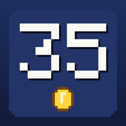

<p align="center"></p>

<h1 align="center">SM35 Recomp</h1>

<p align="center">Super Mario Bros. 35, natively on your computer: a static recompilation of your own copy of the game.</p>

---

SM35 Recomp turns **your own legally dumped** Super Mario Bros. 35 (with its v1.0.2 update) into a native program
for macOS, Windows and Linux (iOS, iPadOS and Android from source). The game's code is translated to C and compiled
for your machine, its system calls run on a native runtime, and its graphics run on Metal or Vulkan. It isn't an
emulator: there is no CPU or GPU emulation at run time.

It is a fork of [SMM2 Recomp](https://github.com/smm2recomp/smm2recomp), which shares its runtime and recompiler.

> **Status: early.** The game boots to its main menu on macOS and the menus work. Everything past the menu (even
> Course Practice) needs the game's online service, which isn't there yet: online play will go through
> [Nextendo Network](https://nextendo.network). See [PROGRESS.md](PROGRESS.md).

## Nothing of the game is included

- This repository and its releases contain **no** game code, assets, keys or firmware, and nothing derived from them.
- You need your own dump of the game, made from a console and cartridge or download you own: the base game, the
  **v1.0.2 update**, and your console's `prod.keys` and firmware.
- The release is a *launcher plus recompiler*: its setup screen checks your files against the known v1.0.2 version,
  and recompiles the game code on your machine. What it builds stays on your machine: don't share it.
- Every commit and every release package is checked for game content (`scripts/check_no_proprietary.py`,
  `scripts/check_package.py`).

SM35 Recomp is not affiliated with, endorsed by or sponsored by Nintendo. Super Mario Bros. 35 and its characters
are trademarks of Nintendo.

## Platforms

| Platform | Graphics | Status |
|---|---|---|
| macOS 15+, Apple silicon | Metal | boots to the main menu |
| Windows 10 / 11, x86-64 (AVX2) | Vulkan 1.3 | builds; untested |
| Linux x86-64 (AVX2) / arm64 | Vulkan 1.3 | builds; untested |
| iOS / iPadOS | Metal | from source; not tried yet |
| Android, arm64 | Vulkan 1.3 | from source; not tried yet |

## Play it

1. Download the package for your system from the [releases](https://github.com/sm35recomp/sm35recomp/releases):
   `SM35Recomp-macos-arm64.zip`, `SM35Recomp-windows-x86_64.zip` or `SM35Recomp-linux-<arch>.tar.gz`.
2. Unpack it and start `SM35Recomp.app` / `sm35recomp.exe` / `./sm35recomp`.
3. The setup screen asks for:
   - your Super Mario Bros. 35 with the 1.0.2 update: the NSP / XCI files, or folders with the extracted ExeFS and
     RomFS;
   - your `prod.keys` and the firmware folder (read where they are, never copied; key values are never shown or
     logged).
4. Press **Set up and play**. The first time it checks and extracts your files, copies the fonts and recompiles the
   game code (a few minutes to half an hour), then the game starts. Later starts go straight to the game.

Keyboard: WASD stick, arrows d-pad, K/J/L/I = A/B/X/Y, Q/E = L/R, 1/3 = ZL/ZR, Enter / Backspace = + / -, F1 or Esc
for the overlay menu. Controllers work through SDL.

macOS: the app isn't notarized. The first time, right-click it and choose Open; if macOS still blocks it, run
`xattr -dr com.apple.quarantine /path/to/SM35Recomp.app`. Windows: see [docs/windows.md](docs/windows.md).

## Build it

On macOS (Apple silicon) with Xcode's command line tools, Homebrew `sdl3` and Python 3.12+, from your own extracted
dump (by default in `~/smm-work/sm35/`: `base-romfs`, `v101-exefs`, `v101-romfs`):

```sh
make -C recomp venv        # once: the recompiler's Python environment
make -C recomp sm35        # check and lay out your dump, recompile, build
make -C recomp run-sm35    # play
```

Linux, Windows (cross-built with zig), iOS, Android and the player packages: [recomp/README.md](recomp/README.md).
Before committing: `scripts/check.sh` (the same gates as CI) and `scripts/install-hooks.sh` (a pre-commit guard).

## Repository

| Path | What |
|---|---|
| `recomp/runtime/` | the runtime: loader, kernel, IPC and services, NVN on Metal / Vulkan, platform layers, setup screen |
| `recomp/tools/` | the recompiler (AArch64 to C) and the packaging scripts |
| `recomp/games/sm35/` | the game's glue: identity, dump setup and version checks, patches |
| `recomp/docs/` | bring-up findings (names and behaviour only) |
| `scripts/` | the proprietary-content guard and the package check |
| `docs/` | Windows guide, toolchain, branding |

## Credits

- [SMM2 Recomp](https://github.com/smm2recomp/smm2recomp): the runtime, recompiler, setup screen and packaging this
  is forked from.
- [LAS Recomp](https://github.com/peiikai/LASRecomp) (MIT), the recompilation of *Link's Awakening* SMM2 Recomp is
  forked from, and [SuperMarioWonderRecomp](https://github.com/BelmanteGu/SuperMarioWonderRecomp) (MIT) for ideas.
- Dear ImGui, SMAA, bcdec, Mbed TLS, SDL3, shaderc, zig, python-build-standalone, capstone, unicorn and hactool:
  see [recomp/UPSTREAM.md](recomp/UPSTREAM.md) and each package's `THIRD-PARTY.txt`.
- [Nextendo Network](https://nextendo.network), for the online play to come.

## Licence

[GPL-3.0-or-later](LICENSE). Third-party code keeps its own licence (MIT, BSD, Apache-2.0, zlib and others): LAS
Recomp's notice is `recomp/LICENSE-LASRecomp`, the rest is listed in [recomp/UPSTREAM.md](recomp/UPSTREAM.md) and in
each release package's `THIRD-PARTY.txt`.
